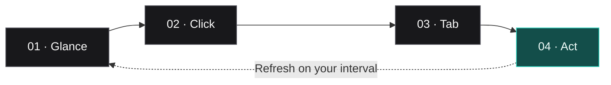
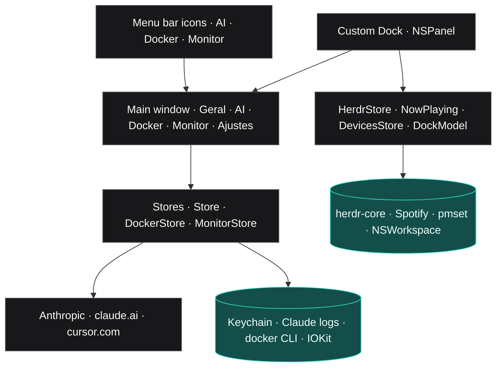

<div align="center">

  <h1>DevStatus</h1>

  <p><strong>Your dev machine, at a glance.</strong></p>

  <p>
    AI usage, Docker storage, system health, coding agents and a Dock of your own — from the macOS menu bar.
  </p>

  <p>
    <a href="#quick-start">Quick start</a>
    &nbsp;&nbsp;·&nbsp;&nbsp;
    <a href="#how-it-works">How it works</a>
    &nbsp;&nbsp;·&nbsp;&nbsp;
    <a href="#documentation">Documentation</a>
  </p>

  <p>
    Personal macOS app · Swift/SwiftUI · No dependencies · No telemetry
  </p>

</div>

> [!NOTE]
> **Personal software.** DevStatus is built for one developer on their own Mac. It reads local credentials and logs, uses a few undocumented macOS APIs (temperature sensors, background cursor) and can replace the system Dock. Read [Privacy and permissions](#privacy-and-permissions) before using it.

## Limits, disks and agents in ten places. One menu bar.

A day of AI-assisted development means checking Claude and Cursor limits in two websites, `docker system df` in a terminal, Activity Monitor for CPU, and a terminal multiplexer for which agent finished. DevStatus pulls all of it into **menu bar stats** and an optional **Dock replacement** with live widgets.

| Without DevStatus | With DevStatus |
| :--- | :--- |
| Open claude.ai and cursor.com to see limits | Usage bars per subscription, numbered, in the menu bar |
| Guess how many tokens you burned | Daily token heatmap from local Claude Code logs |
| `docker system df` and `prune` by hand | Totals per type and prune buttons with confirmation |
| Activity Monitor for CPU, RAM, temperature | Monitor tab and a 2×2 bar icon |
| Switch to the terminal to see which agent is done | Herdr agent queue in the Dock, sorted by who needs you |
| Square Dock icons only | A Dock with wide widgets, Spotify player and battery rings |

## One glance. From menu bar to action.



1. **Glance.** Optional menu bar icons for **AI**, **Docker** and **Monitor**, as horizontal or vertical bars.
2. **Click.** Each icon opens the app focused on its own tab. Spotlight opens it too.
3. **Read the tab.** Cards per subscription, Docker totals, system grid.
4. **Act.** Prune Docker, open the agent that is waiting, add an account — or just close it.

## Built for a working day

### AI usage

Claude Code accounts are discovered automatically (`~/.claude`, `~/.claude-*`) and read from the Keychain the same way Claude Code does. Cursor comes from `cursor-agent`. Any other Claude or Cursor account can be added by pasting the site cookie. Each subscription has a fixed number (reorderable) and a card with its limits, plan, **tokens this month and week** and a shortcut to the provider usage page. A **day-by-day heatmap**, one row per month, covers the last three months.

### Docker

Usage per type (images, build cache, containers, volumes), reclaimable space, and prune for build cache, unused images and the system — always behind a confirmation dialog. Volumes are never pruned.

### Monitor

CPU with history, memory (used, wired, compressed, swap), one card per disk, CPU/SSD/battery temperature, network rates and battery health.

### Menu bar stats

Three optional icons, each with its own refresh interval and orientation. The AI icon draws one bar per subscription in the provider color (Claude orange, Cursor blue), sorted by available quota while keeping each subscription's number.

### Dock replacement

Hides the macOS Dock and draws its own, in groups: **apps** (pinned and running, with a CPU-colored indicator), **Finder and Trash**, the **Herdr agent queue**, **stats widgets** (AI as rings per subscription — weekly and 5-hour limits for Claude, Composer and third-party models for Cursor — with a clock-style logo that empties until the next reset; Docker and Monitor one to four icons wide), a **Spotify player** and **battery rings** for the Mac and its accessories. With Accessibility permission, other windows are kept above it. Turning the option off — or quitting — brings the macOS Dock back exactly as it was.

## Quick start

Requirements: macOS 13+, Swift 5.9+ (Xcode or Command Line Tools). No Xcode project, no package dependencies.

```bash
cd DevStatus
./build.sh                      # release build → DevStatus.app, signed
open DevStatus.app
```

To reload after a change:

```bash
./build.sh && pkill DevStatus; open DevStatus.app
```

On first launch the window opens on its own. From then on use the menu bar icons, Spotlight, or the Dock.

### Stable signing (recommended)

macOS ties permissions to the app signature. With ad-hoc signing every rebuild looks like a new app, and Accessibility, Automation and Keychain access have to be granted again. Put the SHA-1 of a code signing identity in `.sign-identity` (ignored by git), or export `DEVSTATUS_SIGN_IDENTITY`:

```bash
security find-identity -v -p codesigning
echo "<SHA-1>" > .sign-identity
```

### Restore the macOS Dock by hand

If the app is killed while replacing the Dock, the system Dock stays hidden until DevStatus starts again with the option off. To restore it manually:

```bash
defaults write com.apple.dock autohide -bool false
defaults delete com.apple.dock autohide-delay
killall Dock
```

## Privacy and permissions

| What | Why | Where it goes |
| :--- | :--- | :--- |
| Keychain (Claude Code, cookies) | Read usage limits | Only `api.anthropic.com`, `claude.ai`, `cursor.com` |
| Local Claude Code logs | Token counts and heatmap | Nowhere — read on this Mac |
| Accessibility | Keep windows above the custom Dock | Nowhere |
| Automation (Spotify) | Cover art and play/pause/next | Cover image from `i.scdn.co` |
| Login item | "Start with the Mac" | — |
| `herdr-core`, `pmset`, `system_profiler` | Agent queue and battery levels | Nowhere — local CLIs, read only |

Tokens and cookies are never logged, printed or persisted outside the Keychain. OAuth tokens are **never refreshed** by DevStatus, so it cannot log Claude Code out. There is no telemetry or analytics.

## How it works

DevStatus is a single **SwiftUI** app built with **SwiftPM** and packaged by `build.sh` (`LSUIElement`, no Dock icon of its own). Stores refresh on timers and feed the menu bar icons, the main window and the custom Dock.



## Documentation

| Start here | Learn more |
| :--- | :--- |
| [Architecture](docs/architecture.md) | Data sources, APIs, Dock, Herdr, decisions |
| [Development](docs/development.md) | Build, run, testing APIs without the app |
| [Roadmap](docs/roadmap.md) | What is planned and known issues |
| [CLAUDE.md](CLAUDE.md) | Project rules for AI agents working on the code |

## Development

```bash
swift build                     # compile only
./build.sh                      # release .app, signed
pkill DevStatus; open DevStatus.app
```

Stack: **Swift 5.9**, **SwiftUI** + **AppKit**, **IOKit**, **ServiceManagement**, **ApplicationServices** (Accessibility). Target macOS 13+. Sources live in `Sources/DevStatus/`, one file per feature.

## Project status

Under active development for personal use, on one Mac. Undocumented APIs (HID temperature sensors, `SetsCursorInBackground`) and undocumented endpoints (Claude usage) may break with macOS or service updates.

---

<p align="center">
  <strong>See your limits. Free your disk. Know which agent is waiting.</strong><br />
  A menu bar app for the machine you code on.
</p>

<p align="center">
  <a href="#quick-start">Quick start</a>
  ·
  <a href="docs/architecture.md">Architecture</a>
  ·
  <a href="docs/roadmap.md">Roadmap</a>
</p>
